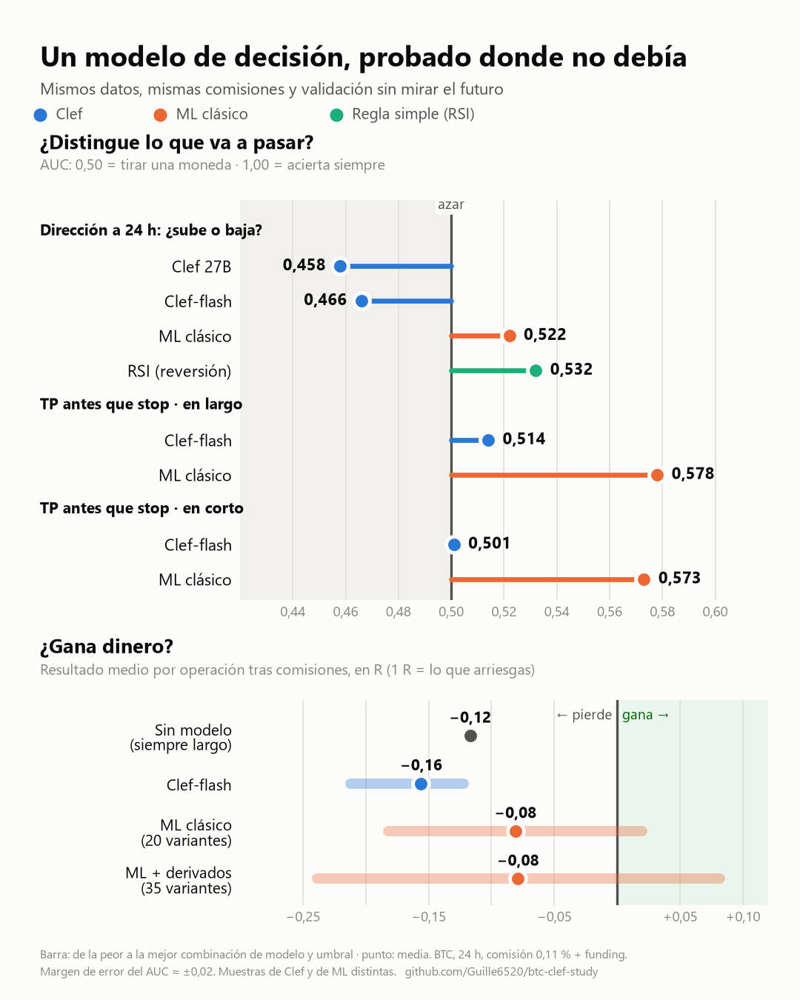
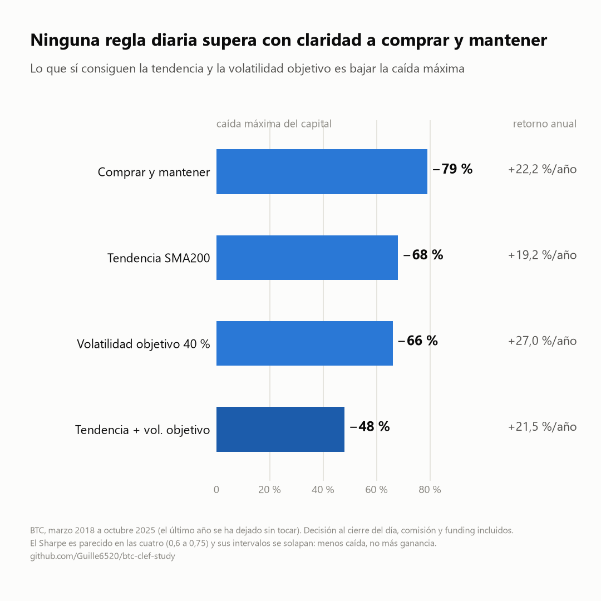

# Estudio del precio de BTC con Clef

[](https://github.com/Guille6520/btc-clef-study/actions/workflows/tests.yml)

[](LICENSE)

¿Puede un modelo de decisión como **Clef** (Cloudflare Workers AI) filtrar buenas operaciones en BTC?
Este repositorio es un banco de pruebas para responderlo con datos y sin autoengaño: se le pregunta a Clef,
vela a vela, cómo acabaría una operación hipotética, se **guarda cada respuesta** y se compara con lo que pasó de verdad.
Después se contrasta con **ML clásico**, datos de derivados, estrategias diarias y el *carry* de funding, con el mismo protocolo y la misma contabilidad de costes.

> **Estado:** investigación en curso, **sin ninguna estrategia rentable por ahora**. Clef (flash y 27B) no tiene señal; un ML clásico simple
> sí la tiene, pero pequeña y no explotable tras costes; y ninguna estrategia diaria bate a comprar y mantener (solo reducen la caída).
> Publicar los resultados malos con la misma honestidad que los buenos es parte del objetivo.
>
> **Aviso:** esto no es consejo financiero ni un sistema de trading. Un backtest, aunque salga bien, no garantiza nada.

## La pregunta

Para cada vela de 1 h de BTC, al cierre, se le plantean a Clef preguntas sí/no con respuesta probabilística:

| Conjunto | Pregunta | Etiqueta real |
|---|---|---|
| `tpsl` | ¿Tocará el take profit antes que el stop en las próximas 24 h? (SL 1,5 × ATR, TP 3 × ATR) | primera barrera tocada |
| `dir` | ¿Estará el precio a 24 h por encima de la entrada? | precio de salida > entrada |

La configuración principal está fijada **antes** de ver resultados. La rejilla de SL/TP (1 / 1,5 / 2 × 1,5 / 2 / 3 ATR) es solo para sensibilidad.

## Metodología (lo que importa para que el resultado valga algo)

- **Sin fuga temporal.** Las features de la vela T usan datos hasta su cierre; la entrada es la **apertura de T+1**.
- **Empates TP/SL en la misma vela.** No se asigna a ciegas ni se descarta: se reproduce esa hora con velas de **1 minuto** y gana lo que
  toque primero. Lo que ni el 1 m decide queda `ambiguous` y se evalúa en el caso pesimista y en el optimista.
- **Realismo de ejecución.** Gaps (fill a la apertura si ya superó el stop), TP como orden límite que debe *atravesarse*, comisiones, slippage
  y **funding real** de la ida a la salida.
- **Estado anonimizado para el modelo.** Sin fechas ni precios absolutos (todo va en unidades de ATR), **pero el estado sí indica que es BTC**. Reduce, **no elimina**, el riesgo de que el
  modelo recuerde el histórico (Clef se basa en Qwen, que ha visto años de BTC). La única validación sin fuga posible es el registro en vivo.
- **Evaluación honesta.** Calibración, AUC, comparación con la tasa base y con una **regresión logística walk-forward**, simulación con una
  posición a la vez, IC por bootstrap de bloques y test de permutación.
- **Todo guardado.** Cada llamada a Clef (estado enviado, probabilidades y respuesta cruda) queda en DuckDB con su versión; nada se paga dos veces.

## Resultados

### Prueba 1: `tpsl` con Clef-flash (muestra aleatoria de 1.988 velas, 2019-2026)

| | Largo | Corto |
|---|---|---|
| Tasa base (TP antes que SL) | 25,1 % | 24,8 % |
| **AUC de Clef** | **0,514** | **0,501** |
| AUC regresión logística (walk-forward) | 0,564 | 0,550 |
| Brier de Clef / de la tasa base | 0,212 / 0,188 | 0,226 / 0,187 |

- Clef-flash **no discrimina** (AUC ≈ 0,50, dentro del margen de error de ±0,03) y está **mal calibrado**: es optimista y peor que predecir siempre la tasa base.
- Las probabilidades altas no aciertan más (en largos, "60-70 %" acertó el 19 %).
- Simulando operar por umbral, **todas** las configuraciones pierden (-0,12 a -0,21 R por operación, con coste de 0,11 %) y el test de permutación no las distingue del azar.
- El modelo clásico saca un edge diminuto (AUC 0,55-0,56) que probablemente no sobrevive a los costes con un payoff 1:2.

Informe completo: [docs/resultados-tpsl.md](docs/resultados-tpsl.md).

### Prueba 2: `dir` con Clef-flash (¿sube a 24 h?; muestra aleatoria de 3.977 velas)

Sirve para separar "Clef no sabe de BTC" de "la pregunta TP/SL es demasiado difícil". Tampoco aquí hay señal:

| | Resultado |
|---|---|
| Tasa base (el precio sube a 24 h) | 52,1 % |
| P media de Clef | 43,8 % |
| **AUC de Clef** | **0,466** |
| Correlación de rangos con el retorno a 24 h | -0,015 (ruido: ±0,031) |
| AUC regresión logística (walk-forward) | 0,514 |
| Brier de Clef / de la tasa base | 0,341 / 0,250 |
| Operar el signo de Clef | 47,3 % de aciertos, **-0,08 ATR netos** por operación (IC90 [-0,18, +0,03]) |

- Clef-flash no predice la dirección y está peor calibrado que una moneda (LogLoss 0,94 frente a 0,69).
- Los extremos apuntan algo hacia el lado equivocado (cuando dice <30 % el precio subió el 55 %; cuando dice >70 %, el 47 %), pero la correlación
  con el retorno es nula y las ventanas de 24 h se solapan. **No es una señal utilizable**: invertir el signo no sería rentable (la media bruta
  pasaría de +0,10 a -0,10 ATR) y elegir el sentido a posteriori sería precisamente el sesgo que este estudio quiere evitar.
- Hasta con un modelo clásico, la dirección a 24 h es casi impredecible con estas features (AUC 0,514).
- **Clef 27B** sobre 596 velas da lo mismo: AUC 0,458, correlación con el retorno +0,014 (ruido: ±0,080) y sobreconfianza extrema (cuando dice >70 %, sube el 45 %).
  El modelo grande no cambia el resultado.

Informe completo: [docs/resultados-dir.md](docs/resultados-dir.md).

### Prueba 3: ML clásico, derivados y estrategias de baja frecuencia

Walk-forward por años con embargo de 25 h, hiperparámetros fijos y **reserva ciega del último año sin tocar**. En resumen (detalle en
[docs/resultados-ml-clasico.md](docs/resultados-ml-clasico.md)):



| | Clef-flash | Mejor ML clásico |
|---|---|---|
| AUC TP antes que SL (largo / corto) | 0,514 / 0,501 | **0,578 / 0,573**, positivo en todos los años |
| AUC dirección a 24 h | 0,466 | 0,522 (la heurística de reversión por RSI, 0,532) |
| Volatilidad futura (Spearman) | no probado | **0,46** (R² fuera de muestra 0,22) |

- **La volatilidad es predecible; la dirección, casi no.** Un AUC de 0,58 en TP/SL mejora el ranking, pero con 1:2 y costes del 0,11 % **todas** las
  simulaciones siguen perdiendo (-0,02 a -0,18 R por operación; siempre largo: -0,12 R).
- **Los datos de derivados no aportan** (open interest, prima, volumen agresor, DVOL, macro): con este protocolo empeoran el modelo.
- **A baja frecuencia** los costes casi desaparecen, pero ninguna regla estándar bate a comprar y mantener (Sharpe 0,64, caída -79 %). Tendencia SMA200
  más volatilidad objetivo da Sharpe 0,74 con **caída -48 %**: gestión de riesgo, no *alpha*.
- **Carry de funding:** de +4 % a +31 % anual según el año; en 2025 ≈ +5 %, comparable al bono a 10 años.



- **Una pista que no resiste:** la *continuación* tras extremos de RSI parecía robusta (replicada en un periodo y en activos no vistos), pero la media la sacan
  pocas operaciones, la peor es -16 % del precio sin stop y con 0,1 % extra de deslizamiento se queda en +5 %/año (BTC), frente a +22 % de comprar y mantener.

**Conclusión provisional:** ni Clef ni un ML clásico con datos públicos dan una estrategia direccional rentable tras costes. Lo realista es
gestión de riesgo (tendencia y volatilidad objetivo, dimensionado con la volatilidad predicha). Por eso no se lanzó la pasada completa de ~79.000 velas con Clef.

## Limitaciones conocidas

- Clef solo se probó **zero-shot**, con **un** formato de estado y **una** formulación de pregunta (flash en ~2.000 y ~4.000 velas, 27B en ~600). No se puede
  concluir sobre fine-tuning ni sobre otras formulaciones.
- El benchmark clásico usa **hiperparámetros fijos**: un ajuste fino podría mejorar el AUC, pero también el riesgo de sobreajuste.
- Sin liquidaciones ni opciones (solo DVOL). Casi todo es BTC; ETH y SOL solo se usaron para replicar la pista del RSI.
- Entrada simulada a mercado con coste conservador, sin modelar el fill de órdenes límite ni la selección adversa; los escenarios de comisión baja son optimistas.
- Se han probado muchas variantes; ninguna celda concreta debe tomarse como hallazgo. Los datos de 2017-2021 son un mercado alcista excepcional.
- Posible fuga por memorización del histórico en Clef (ver metodología). La **reserva ciega** (desde 2025-10-14) sigue sin usar y debe evaluarse **una sola vez**.

## Reproducirlo (Windows / PowerShell)

```powershell
python -m venv .venv
.\.venv\Scripts\python.exe -m pip install -r requirements.txt
Copy-Item .env.example .env        # rellena CLOUDFLARE_ACCOUNT_ID y CLOUDFLARE_API_TOKEN
.\.venv\Scripts\python.exe -m clefbt download     # velas 1h + funding (Binance, público)
.\.venv\Scripts\python.exe -m clefbt label        # etiquetas TP/SL/tiempo, resuelve empates con 1m
.\.venv\Scripts\python.exe -m clefbt probe        # una llamada real a Clef: verifica el formato
.\.venv\Scripts\python.exe -m clefbt run --dry    # cuántas llamadas y tokens, antes de gastar
.\.venv\Scripts\python.exe -m clefbt run --sample 2000
.\.venv\Scripts\python.exe -m clefbt evaluate     # informe (se guarda en reports/)
# pregunta direccional
.\.venv\Scripts\python.exe -m clefbt run --qset dir --sample 2000
.\.venv\Scripts\python.exe -m clefbt evaluate --qset dir
# ML clásico y estrategias (no necesitan Cloudflare)
.\.venv\Scripts\python.exe -m clefbt bench                  # walk-forward purgado: direccion, TP/SL, volatilidad
.\.venv\Scripts\python.exe -m clefbt download-derivs        # open interest, prima, volumen agresor, DVOL, macro
.\.venv\Scripts\python.exe -m clefbt bench --derivs         # el mismo benchmark con derivados, sobre el periodo comun
.\.venv\Scripts\python.exe -m clefbt daily                  # estrategias diarias y carry de funding
.\.venv\Scripts\python.exe -m clefbt extremes               # continuacion en extremos de RSI (BTC, ETH, SOL)
# la reserva ciega se evalua UNA sola vez, con la estrategia ya decidida:  bench --final / daily --final / extremes --final
```

En consola de Windows, si un informe falla al imprimir caracteres especiales, ejecuta antes `$env:PYTHONIOENCODING = "utf-8"`.

Notas de coste (medidas): Clef-flash gasta ~2,55 neuronas por llamada de 2 preguntas (~740 tokens). El plan gratuito de Workers AI da 10.000
neuronas al día y la cuota es **por cuenta**; si se agota, `run` se detiene limpio y es reanudable.

## Tests

```powershell
.\.venv\Scripts\python.exe -m pip install -r requirements-dev.txt
.\.venv\Scripts\python.exe -m pytest -v
```

47 tests, **offline** (velas sintéticas, DuckDB en memoria y respuestas simuladas de Clef: sin red, claves ni datos descargados), y se ejecutan
en GitHub Actions en cada push y pull request. Se centran en lo que, si falla, da resultados falsos sin avisar:

- **Etiquetado:** TP/SL/tiempo, entrada en la apertura siguiente, gaps, empates en la misma vela (resueltos con 1m o dejados como `ambiguous`,
  nunca adivinados), TP que debe *atravesarse* y stop que cuenta al alcanzarse, y funding solo durante la operación.
- **Sin fuga temporal:** las features hasta la vela *t* no cambian si se alteran las velas posteriores; el estado no lleva fechas ni precios absolutos.
- **Evaluación:** AUC, Brier, LogLoss y la simulación con una sola posición a la vez.
- **Cliente de Clef:** versiones de caché estables, parseo de la respuesta real, la cuota agotada (4006) detiene sin reintentar y el token nunca aparece en un error.
- **Benchmark clásico:** el embargo se respeta, la reserva ciega nunca entra en el entrenamiento, los datos de derivados y los diarios se alinean sin mirar el futuro
  (la instantánea de las 12:05 pertenece a la vela de las 12:00; el dato diario del día D llega con un día de retraso) y las estrategias diarias cobran la posición el día siguiente.
- **Regla de extremos de RSI:** una posición a la vez y retorno futuro desde la apertura siguiente.

Los tests se validaron con *mutaciones*: se introdujeron a propósito 23 errores en copias del código (ignorar el gap, contar el TP al rozarlo,
mirar el futuro en una feature, quitar el embargo, entrenar con la reserva ciega, filtrar el token…) y **la suite detectó los 23**.

## Estructura

```
config.toml          parámetros (SL/TP/plazo fijados, costes, umbrales, modelo)
tests/               suite offline (pytest)
.github/workflows/   CI: tests en cada push y pull request
clefbt/
  data.py            velas 1h/1m (Binance vía ccxt) y funding
  features.py        features y estado anonimizado para Clef
  labeling.py        etiquetado triple barrera sin sesgo de empate
  clef.py            cliente Workers AI con caché y control de cuota
  evaluate.py        calibración, baselines, simulación, permutación
  classic.py         benchmark de ML clásico con walk-forward purgado (dirección, TP/SL, volatilidad)
  derivs.py          open interest, prima, volumen agresor, DVOL, miedo y avaricia, macro (fuentes gratuitas)
  daily.py           estrategias diarias y carry de funding
  rules.py           reglas de RSI (contraria y continuación) y su robustez
docs/                resultados, gráficos (img/) y make_charts.py que los genera (requiere matplotlib)
```

## Próximos pasos

- Gestión de riesgo con la volatilidad predicha: dimensionar posiciones y colocar stops según la volatilidad esperada, y medir la mejora en Sharpe y caída.
- Simular el fill de órdenes límite (selección adversa) para saber si las comisiones *maker* son alcanzables.
- Variante del estado de Clef sin mencionar el activo (`state_version` v2) y Clef como *feature* junto al modelo clásico.
- Registro en vivo cada hora (`clefbt live`), la única validación sin fuga.
- Evaluar la reserva ciega **una sola vez**, cuando haya una estrategia decidida.

## Licencia

MIT. Ver [LICENSE](LICENSE).
